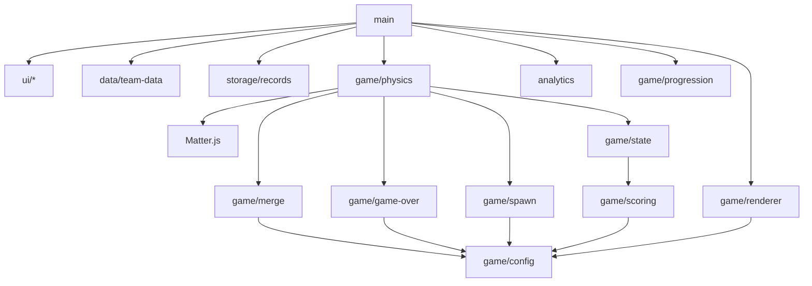

# 模块、接口与物理设计

C实际新增src/data/teams.json、team-data.js、game/progression.js、game/anthem.js和scripts/{sync-teams.mjs,official-annual.mjs}；本命选择复用main，不单拆picker。public包含2026年总12队队徽及20首战歌（12正常版+8小孩版）。app/data/team_anthems.json按canonical ID记录双版本/来源/哈希，sync-teams显式生成schemaVersion=2独立快照；anthemForLevel(team, level, mode)按normal/child全局模式选择所有等级的音源，缺少小孩版时选本队正常版，无默认曲；main拥有musicMode，每次开局/重开设为normal，右上角按钮切换版本并立即调用当前等级选曲，暂停/静音时不启动媒体。docs/annual-2026-source.json保存官方名单原响应，data-provenance.json保留canonical映射/哈希。同步annual严格指定2026，大师/精英各6队、12队唯一canonical映射；只清理旧快照明确管理的不再使用资源。session回传合成/停止/恢复事件，投放仅更新球信息，main映射锁定路线并播放单个媒体。main拥有当前访问的每个音源游标Map，正常版与小孩版互不覆盖进度，播放器持有3个媒体listener，没有timer；首次合成超过本局战歌等级时切歌时保存实际currentTime，同曲保持播放，媒体loop保证整曲结束仍持续播放；timeupdate在循环回零时跳到本曲歌词起点。旧token不介入新曲。开局手势同步播放L0；main独立保留本局最高已合成的战歌等级；merge-feedback仅管理当前组合成的计分，onResume及取消静音续播对应曲，普通暂停/hidden/settling/over不启动媒体，本命弹窗仅暂停物理而继续本命战歌。暂停/隐藏/重开/换队/结束/destroy停止/释放src，destroy移除监听；应用destroy清空游标。main复用现有选队流程提供明确导航按钮，游戏中心通过普通站内链接返回平台首页。renderer接收本局八张预加载图片。其余目标模块按需创建，不提前建立records/result/analytics。

同日第二轮交互修订：桌面两侧记分、窗口高度自适应和可选浏览器全屏；移除可见Next/L7次数，内部队列不改。renderer将合成反馈改为输出球弹动/内部亮度，不再绘制光圈；session管理按压状态、指针/键盘焦点区别和投放挤压；main管理两侧数字、冷却进度及场内状态提示。未新增未来UI/data/records模块；下面早期“上方浮分/光圈”表述已被这次授权修改。

2026-10-07 的 B 手感修订只修改现有物理/渲染/队列模块，没有进入未来架构。当前半径 [20,28,38,50,64,82,104,132]，spawnY=72、restitution=0.42、friction=0.1、frictionAir=0.008；自然生成随已达等级扩到少量 L3/L4。早期半径/阻尼推导是 A 的历史起点，当前参数以 config.js 与 B_TUNING_20261007.md 为准。collisionStart 同时采集达到速度阈值的碰撞反馈，事务后仅向仍存在的球发送；反馈由本局renderer拥有、过期和清理。主入口在上方计分区显示浮分。

状态：以下是 A 的目标架构，不要求 B 提前建立全部模块。B 实际只实现 config/spawn/merge/game-over/physics/renderer/session 和薄 main，结构与验证见 B_REPORT.md。采用 plain JavaScript ESM + Vite + Matter.js；B 固定 Vite 7.3.6、Matter.js 0.20.0 和 lockfile。参考版 std_Suika 使用 ^0.19.0，不能视为同版本运行证据。

B 合并事务在 Engine.update 返回后执行，等价于该步求解完成后的提交点，避免额外 afterUpdate 监听和在 solver 内改 world。计分状态暂放 physics，不为几行字段创建 state/scoring 文件；输入/RAF 的会话所有权集中在 session。没有创建未来 UI/data/storage/analytics 模块。

## 模块职责

| 文件 | 一句话职责 |
| --- | --- |
| src/main.js | 组合数据、UI、会话、输入与生命周期；只做编排。 |
| src/game/config.js | 唯一等级、半径、分数、权重、物理参数和结束阈值配置。 |
| src/game/progression.js | 从合格池生成并冻结本命在 L7 的八队路线。 |
| src/game/spawn.js | 校验分阶段抽样并持有current/next队列，首球固定L0。 |
| src/game/merge-feedback.js | 保留逐项加分、连锁总分和本组合成最高输出等级。 |
| src/game/scoring.js | 校验输出等级并返回唯一分数表的分数。 |
| src/game/merge.js | 认领有效同级球并计算输出描述，阻止重复和 L7 合并。 |
| src/game/game-over.js | 用注入的模拟时钟检测持续稳定越线。 |
| src/game/state.js | 更新 score/finalCount/maxLevel/phase 等纯局内状态。 |
| src/game/physics.js | 适配 Matter world、固定步长、球生命周期、碰撞与结束。 |
| src/game/renderer.js | 用 Canvas 绘制物理圆、队徽、预览、危险线和限时反馈。 |
| src/data/team-data.js | 校验已提交的小快照并生成本游戏资源 URL。 |
| src/ui/team-picker.js | 渲染队徽选择和可访问的选中状态。 |
| src/ui/hud.js | 仅在变化时更新比分、本命、下一球和暂停状态。 |
| src/ui/progression-view.js | 展示可折叠随机合成路线及最终目标。 |
| src/ui/result.js | 显示结果与重开、更换、返回操作。 |
| src/storage/records.js | 安全读取、验证和写入本地选择与全局/战队记录。 |
| src/analytics.js | 只转发固定事件至可选 KPLAnalytics helper，失败静默。 |
| scripts/sync-teams.mjs | 显式从本地 canonical 重建快照与必要队徽，记录来源哈希。 |

renderer 单列是因为每帧绘制与 Matter 更新生命周期不同；输入由 main 绑定到游戏区域，暂不拆 input 类或事件总线。纯逻辑不导入 DOM、Matter、localStorage 或 analytics；UI 不直接修改 world。

通过传入 callbacks/读模型回传事件，上图无反向引用。E 用静态 import 图检查循环及每模块职责；不引入依赖注入容器或共享平台组件包。

## 数据与事件接口

- Team = {id:string, name:string, shortName:string, icon:string}；id 保持原始 franchise_id；icon 合约可用 /team-icons/<id>.png，但 team-data 将其转换为 base-relative 的 ./team-icons/ URL，不能请求域名根目录而破坏 /merge/。
- Progression = 冻结的 8 个 Team；createProgression(teams, selectedId, rng) 校验至少 8 支，拒绝重复 ID 和未知本命。
- SpawnQueue = {currentLevel, nextLevel}；take() 仅在允许投放时推进一次，返回投放前 current，不重新抽本次等级。UI 分别展示待投和 next。
- Ball = {id, level, position, velocity, radius, releasedAt, graceUntil, consumed}；只有 physics 管理真实 body 映射，preview 无 id/world 实体。
- 合成事件 = {inputIds:[a,b], outputId, level, x, y, points, time}；points 只在原子合成成功后生成。state 提交一次、renderer 追加一次短反馈，main 按 level===7 更新记录和事件。
- status = picking / playing / paused / settling / result；一个会话只有一个引擎与 RAF 链。destroy() 幂等；重开销毁旧实例后创建新实例。

## 固定步长与合并事务

Matter 圆体+三面静态墙复用成熟实现。采用固定世界 400×600、固定步长 1000/60ms、RAF 累积器，限制单帧补步数以防后台切回追赶。此尺寸是从 std_Suika 620×850 的玩法比例适配，不照搬其宽桌面 UI。CSS 缩放到最大约 440px；世界不随 viewport 重建，renderer 根据 DPR 创建 backing store，Pointer 用 boundingClientRect 映射世界坐标。resize 不改变等级半径或正在运行的路线。

候选半径来自 std_Suika 首 8 级 [16.5,24,30.5,34.5,44.5,57,64.5,78]×(400/620)，约 [10.65,15.48,19.68,22.26,28.71,36.77,41.61,50.32]。最小级 logo 辨识度是风险，B/C 必须实测，必要时整组等比调整或选择来源中更适合的 8 级子序列；不散写调参。L7 直径约占箱宽 25%，可以容纳多颗；这只是几何检查，手感仍未验证。

起始 restitution 参考 0.1～0.2 范围；friction/frictionAir、最大速度、危险线约 y=90、投放冷却约 500ms、新投 grace 约 1000ms、合成 grace 约 500ms、稳定持续 1800ms、稳定速度候选 1.0px/tick 都集中 config。危险线、半径、速度、grace 是待 B 调试的工程参数，精确计分和八级规则不可调。

碰撞回调先收集候选对，并同时处理 collisionStart/collisionActive，避免同级球已贴合却错过合并。逐对检查有效 ID/level/consumed，在当前步同步认领两个输入；afterUpdate 执行移除与创建事务。旧 body、映射、越线计时同步删除；合成输出进入下一模拟步才参与新合成。新位置 clamp 保证不在墙/地板外；速度按输入质量加权再 cap。结束 phase 不再提交合成/分数，settling 只做视觉稳定。

## 显示与资源生命周期

一张 Canvas 承担世界和反馈；预加载仅本局 8 支队徽，失败显示简称，不悄悄联网。logo 按图片真实宽高 contain 到整个碰撞直径（LOGO.diameterFactor=2），无额外底板/圆框；缩放只影响绘制，不缩放碰撞边缘。封面每张图片最多一次带不同URL重试，错误不永久隐藏图片。特效使用有截止时间、有数量上限的数组；不需要每帧创建 DOM。main将短暂浮分与持续显示的上次合成值分开：新outputId才更新合成大字，过期只移除浮分。危险状态带文字和虚线，成绩变化用节流 aria-live。

hidden/暂停停止物理计时和 RAF，恢复清空 accumulator/lastTimestamp；blur/pointercancel 清除投放手势，不执行释放。AbortController 管理 DOM listeners，Matter Events.off、Engine.clear、Composite.clear、cancelAnimationFrame、ResizeObserver.disconnect 和 timers 都在 destroy 中完成。每局销毁后检验 world 仅空实例，不留旧圆体。

## 构建和平台接入

独立 Vite base './'，队徽存 public/team-icons，小快照存 src/data/teams.json，来源存 docs/data-provenance.json。scripts/sync-teams.mjs 必须有 --source，只在维护时执行；build 无另一个仓库也必须成功。第三方 license notices 随静态输出分发。

F 追加 games.json：merge / 合成KPL / KQ-KUN/kpl-merge / /merge/ / 物理合成 / 一路合成，直到本命 / accent purple / 自有手工 SVG 合成标记 / enabled:false。新增 npm 构建契约，不伪造 ref；正式启用前才填经过验证的远端 commit。

统一 helper 由平台 collect 注入，独立运行 helper 可不存在，不能强行请求导致 404。main 在资产与初始化成功后调用可选 trackPageView('merge')；平台当前 helper 自动 pageview，F 需明确避免与初始化调用重复且定义一致。统计只扩展 allowlist/路径表/周报字段，merge-final 可每局多次，因此 final/start 是产出比，绝非用户转化率；merge-gameover/start 也不是严格同期漏斗。
